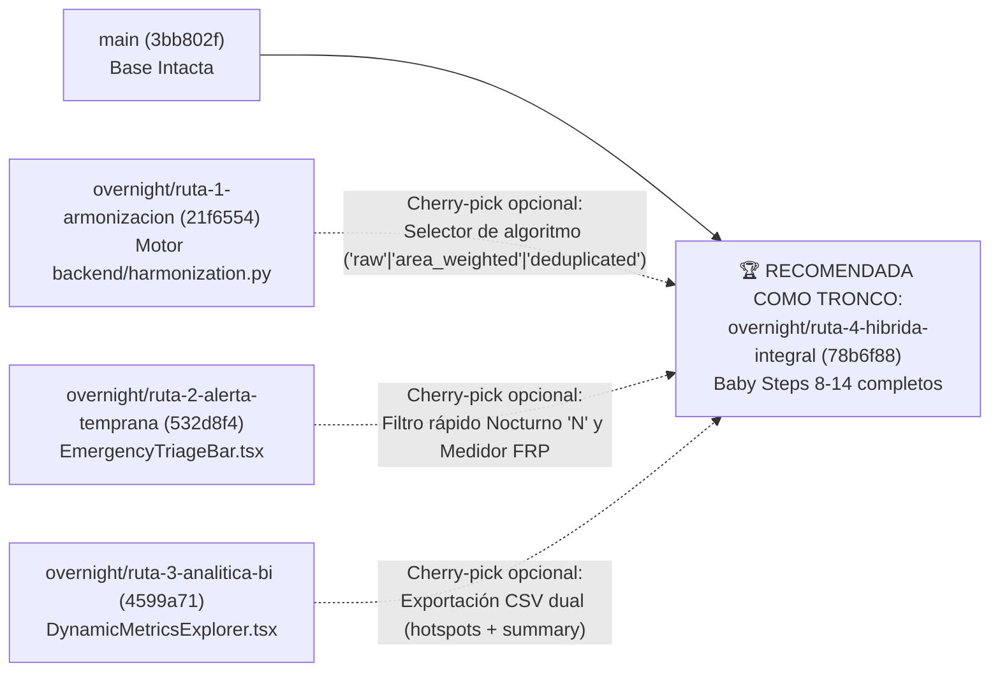

# 🌅 TABLERO EJECUTIVO DE DECISIÓN — 9:00 AM (GUARDIA NOCTURNA NASA SPACE APPS 2026)

> **Estado del Repositorio Principal (`main`):** Intacto en el commit `3bb802f` (`0` archivos de código modificados en `main`).  
> **Estado de las 4 Ramas Overnight:** 100% implementadas, compiladas (`tsc --noEmit` + `vite build` con `0` errores) y auditadas con tests automatizados en verde por `@verifier-qa`.

---

## 1. RESUMEN EJECUTIVO PARA LAS 9:00 AM

Durante la sesión nocturna se completaron dos líneas de trabajo en paralelo sin alterar tu rama principal (`main`):

1. **Investigación de Industria y Modelos Matemáticos de Armonización (para compartir hoy con tus compañeros del Equipo de Datos 1 y 2):**
   - [01_INDUSTRIA_SISTEMAS_REALES.md](./01_INDUSTRIA_SISTEMAS_REALES.md): Cómo resuelven la superposición multi-satélite **NASA FIRMS**, **Copernicus EFFIS**, **GWIS**, **INPE Programa Queimadas** y **CONAE Argentina** (taxonomía de 4 generaciones `G1`–`G4`, uso de **Mediana Histórica $P_{50}$** y percentiles $P_{25}/P_{75}/P_{90}$ en lugar de media aritmética, y los 4 gráficos estándar de producción).
   - [02_MODELOS_MATEMATICOS_ARMONIZACION.md](./02_MODELOS_MATEMATICOS_ARMONIZACION.md): Tres métodos matemáticos concretos con fórmulas y código Python de referencia para el período de solapamiento **2012–2026**:
     1. *Ponderación por Área Instantánea (`pixel_geom`)* corrigiendo el efecto *bow-tie* de MODIS ($1.0\text{ km}^2$) frente a VIIRS ($0.14\text{ km}^2$).
     2. *Calibración de FRP por Cuantiles (CDF Matching)* $F_{\text{MODIS}}^{-1}(F_{\text{VIIRS}}(\text{FRP}))$ corrigiendo la saturación de la Banda I-4 de VIIRS.
     3. *Deduplicación Espacio-Temporal Cilíndrica* mediante grafo de adyacencia con radio adaptativo $r_i = \sqrt{A_i/\pi}$ y ventana $\Delta t \le \tau$.

2. **Cuatro Ramas Funcionales de Punta a Punta (con sus Planos Arquitectónicos Autocontenidos):**
   - Cada rama implementa el **Contrato de 10 Conceptos Canónicos** (`docs/TEAM_DATA_CONTRACT.md`, sin el campo `version`), cumple la **Regla de Oro de Extensibilidad (Open/Closed Principle)** mediante descriptores declarativos + `analysis_metrics`, incorpora las **4 Generaciones Satelitales (`G1` 1000m $\rightarrow$ `G4` 375m)** con huella física real en metros (`<Circle>` con `zOrder`), el **Calendario Funcional de Actividad de Quema**, la **Exportación CSV en 1 clic** (`GET /api/aoi/export.csv`) y el **Switch de 1 sola línea a Base de Datos Real** (`DATA_SOURCE_MODE = "stub" | "database"` en `backend/team_contract.py`).

---

## 2. TABLA COMPARATIVA DE LAS 4 RAMAS AUDITADAS

| Criterio | 🔬 Ruta 1: Armonización Científica | 🚨 Ruta 2: Alerta Temprana Operativa | 📊 Ruta 3: Explorador Analítico BI | ⚖️ Ruta 4: Híbrida Balanceada (Recomendada) |
| :--- | :--- | :--- | :--- | :--- |
| **Rama Git** | `overnight/ruta-1-armonizacion` | `overnight/ruta-2-alerta-temprana` | `overnight/ruta-3-analitica-bi` | `overnight/ruta-4-hibrida-integral` |
| **HEAD / Commits** | `21f6554` (4 commits sobre `main`) | `532d8f4` (5 commits sobre `main`) | `4599a71` (7 commits sobre `main`) | `78b6f88` (7 commits: Baby Steps 8–14) |
| **Plano Arquitectónico** | [RUTA_1_ARMONIZACION_CIENTIFICA.md](./RUTA_1_ARMONIZACION_CIENTIFICA.md) | [RUTA_2_ALERTA_TEMPRANA_OPERATIVA.md](./RUTA_2_ALERTA_TEMPRANA_OPERATIVA.md) | [RUTA_3_EXPLORADOR_ANALITICO_BI.md](./RUTA_3_EXPLORADOR_ANALITICO_BI.md) | [RUTA_4_HIBRIDA_BALANCEADA.md](./RUTA_4_HIBRIDA_BALANCEADA.md) |
| **Foco Principal** | Calibración estadística MODIS/VIIRS en vivo | Triaje táctico de emergencias y manejo del fuego | Business Intelligence, histogramas y widgets dinámicos | Equilibrio integral (Plan Maestro BS 8–14) |
| **Diferencial Único** | Selector en vivo de 3 motores en `backend/harmonization.py`: `'raw'`, `'area_weighted'` ($1\text{ km}^2$ vs $0.14\text{ km}^2$) y `'deduplicated'` (Haversine $\le 1.8\text{ km}$, $\Delta t \le 6\text{h}$) + presets de picos históricos (2020/2024). | `EmergencyTriageBar.tsx` (filtro rápido de **Focos Nocturnos `N`**, Confianza Alta, umbral `FRP >= 30/60/90 MW`, zoom a frente activo), `DayNightAlertSvgCard` y `FrpPowerMeterSvg`. | Suite de 4 gráficos SVG en pestañas (`SeasonalAnomalyBarChart`, `FrpHistogramChart`, `GenerationAndDayNightChart`, `DynamicMetricsExplorer` recursivo) + doble CSV (`kind=hotspots\|summary`). | `<Pane>` Leaflet por generación (`G1` fondo $\rightarrow$ `G4` frente), `GenerationLegendCard` con checkboxes de visibilidad por satélite, `InteractiveCalendar` (26×12) y `AnalyticsWidgetsKit` (4 widgets). |
| **Huella en Metros (`G1`–`G4`)** | Radio Toggle flotante (`<Circle>` 1000m a 375m con `zOrder`) | Modo auditoría física + clústeres VIIRS 375m anidados en halo MODIS 1000m | `<Pane>` por generación + anillo guía sub-píxel | `<Pane>` por generación (`zOrder` 410–440) + toggles individuales G1–G4 |
| **Swap 1 Línea a BD Real** | `DATA_SOURCE_MODE = "stub"` en `team_contract.py` (`get_hotspot_dataset`) | `DATA_SOURCE_MODE = "stub"` en `team_contract.py` (`fetch_raw_data_from_source`) | `DATA_SOURCE_MODE = "stub"` en `team_contract.py` (3 adaptadores desacoplados) | `DATA_SOURCE_MODE = "stub"` en `team_contract.py` (`fetch_raw_rows` + `fetch_monthly_counts`) |
| **Auditoría QA (Tests / TS)** | ✅ `6/6 tests OK` \| `tsc: 0 err` \| `vite build OK` | ✅ `8/8 tests OK` \| `tsc: 0 err` \| `vite build OK` | ✅ `5/5 tests OK` \| `tsc: 0 err` \| `vite build OK` | ✅ `10/10 tests OK` \| `tsc: 0 err` \| `vite build OK` |

---

## 3. RECOMENDACIÓN ARQUITECTÓNICA DEL TEAM LEADER



- **¿Con cuál empezar a las 9:00 AM?** Empieza probando **`overnight/ruta-4-hibrida-integral`**: sigue paso a paso los Baby Steps 8 al 14 acordados, tiene 10 tests unitarios automatizados en el backend, maneja el apilamiento físico en metros con `<Pane>` de Leaflet más checkboxes individuales por generación (`G1`–`G4`), tiene el calendario 2001–2026 completo (26×12) con descarga CSV y el kit analítico SVG integrado.
- **¿Si el jurado o el equipo de datos quiere ver la calibración matemática en vivo?** Muestra o fusiona el selector de algoritmo de **`overnight/ruta-1-armonizacion`** (`backend/harmonization.py`), que permite alternar en vivo entre *Crudo*, *Ponderado por Área* y *Deduplicado*.

---

## 4. CÓMO PROBAR CADA UNA DE LAS 4 RAMAS EN 30 SEGUNDOS

### Opción A: Hacer `git checkout` directamente en tu repositorio principal

> **Nota importante sobre Worktrees:** Durante la noche las 4 ramas se construyeron en worktrees aislados (`/tmp/overnight-worktrees/ruta-1..4`) para no tocar tu rama `main`. En Git, una rama que está abierta en un worktree secundario requiere liberar primero los worktrees temporales antes de hacer `git checkout` sobre ella en el repositorio principal. Ejecuta una sola vez este comando de limpieza antes de cambiar de rama:

```bash
cd "/home/juan/Documentos/WebApp Mapa interactivo"
git worktree remove /tmp/overnight-worktrees/ruta-1
git worktree remove /tmp/overnight-worktrees/ruta-2
git worktree remove /tmp/overnight-worktrees/ruta-3
git worktree remove /tmp/overnight-worktrees/ruta-4
```

Una vez liberados los worktrees temporales, cambia entre cualquiera de las 4 ramas con un solo comando:

```bash
# 1. Probar RUTA 1 (Armonización Científica Máxima)
git checkout overnight/ruta-1-armonizacion

# 2. Probar RUTA 2 (Alerta Temprana y Triaje Operativo)
git checkout overnight/ruta-2-alerta-temprana

# 3. Probar RUTA 3 (Explorador Analítico BI y Gráficos SVG en Pestañas)
git checkout overnight/ruta-3-analitica-bi

# 4. Probar RUTA 4 (Híbrida Balanceada Integral — Baby Steps 8 al 14)
git checkout overnight/ruta-4-hibrida-integral

# Volver en cualquier momento al punto exacto de ayer a la noche:
git checkout main
```

Para levantar el **Backend** y el **Frontend** en la rama elegida (en dos terminales):

```bash
# Terminal 1 — Backend FastAPI (Puerto 8000)
cd "/home/juan/Documentos/WebApp Mapa interactivo/backend"
./.venv/bin/uvicorn main:app --reload --port 8000

# Terminal 2 — Frontend Vite + React (Puerto 5173)
cd "/home/juan/Documentos/WebApp Mapa interactivo/frontend"
npm run dev
```

---

### Opción B: Probar cada rama directamente desde su carpeta `/tmp/overnight-worktrees/` sin tocar `main`

Si prefieres mantener tu carpeta principal clavada en `main` mientras comparas las 4 rutas, puedes correr los tests o inspeccionar cualquiera de los 4 directorios directamente:

```bash
# Ver el historial limpio de Baby Steps de cada rama:
git log main..overnight/ruta-1-armonizacion --oneline
git log main..overnight/ruta-2-alerta-temprana --oneline
git log main..overnight/ruta-3-analitica-bi --oneline
git log main..overnight/ruta-4-hibrida-integral --oneline
```

---

## 5. CÓMO HACER EL SWAP DE 1 SOLA LÍNEA CUANDO EL EQUIPO DE DATOS TERMINE

En las 4 ramas, cuando tus compañeros de los tracks de MODIS y VIIRS entreguen su dataset unificado:

1. Abre `backend/team_contract.py`.
2. Si algún nombre de columna de su tabla final cambió respecto al provisional, actualiza únicamente el string derecho en `TEAM_FIELD_MAP`.
3. Cambia la constante de modo de datos en **1 sola línea**:
   ```python
   DATA_SOURCE_MODE = "database"  # Antes: "stub"
   ```
4. Cualquier métrica estadística extra que tus compañeros agreguen al dataset se volcará automáticamente en `analysis_metrics` y se renderizará en la sección desplegable del panel lateral sin modificar el código JSX.
