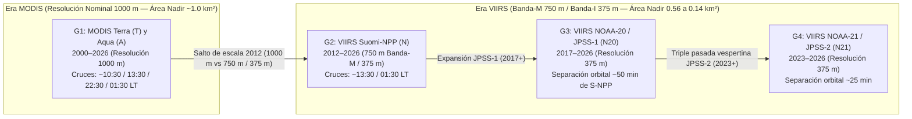
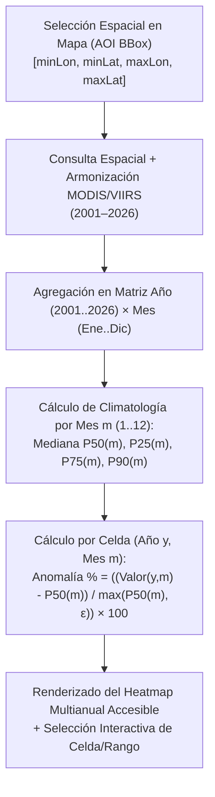

# 01 — Estudio de Industria: Sistemas Reales de Monitoreo Satelital y Alerta Temprana de Incendios

> **Documento Técnico de Referencia — NASA Space Apps Challenge 2026**
> **Desafío:** *Harmonization of MODIS and VIIRS Hot Spots* (Autora: Marina Campanucci, CONAE — Argentina)
> **Propósito:** Documentar cómo operan en producción los 5 sistemas líderes a nivel mundial y regional (**NASA FIRMS**, **Copernicus EFFIS**, **GEO/Copernicus GWIS**, **INPE Programa Queimadas** y **CONAE Argentina**), cómo resuelven la superposición multi-satélite (MODIS 1 km vs. VIIRS 375 m), qué métricas y alertas exponen al operador táctico y científico, cómo diseñan sus calendarios de actividad y anomalías históricas, y qué visualizaciones utilizan realmente en producción.

---

## 1. Panorama Comparativo de los 5 Sistemas Líderes

| Sistema / Agencia | Cobertura y Enfoque Principal | Constelación Base Consumida | Estrategia frente a la Superposición MODIS vs. VIIRS | Producto Estrella de Calendario / Anomalía |
| :--- | :--- | :--- | :--- | :--- |
| **NASA FIRMS** *(Fire Information for Resource Management System)* | Global; distribución NRT (*Near Real-Time* < 3h) y archivo científico estándar (*Standard Processing*). | MODIS (**Terra**, **Aqua** — 1 km) y VIIRS (**Suomi-NPP**, **NOAA-20**, **NOAA-21** — 375 m), más Landsat y geoestacionarios (GOES, Meteosat, Himawari). | Renderizado en capas separables o apiladas con **huella geométrica real del píxel** (*actual pixel footprint* $\Delta S \times \Delta T$ considerando distorsión *bow-tie*) y codificación temporal desde la detección (<1h, 1–6h, 6–12h, 12–24h). | **Time-Based Fire Map** + series históricas de archivo (`MCD14ML` desde Nov 2000 y `VNP14IMGTDL` desde Ene 2012). |
| **EFFIS** *(European Forest Fire Information System — JRC / Copernicus)* | Pan-Europea, Norte de África y Medio Oriente; gestión táctica de protección civil y evaluación rápida de daños. | MODIS (1 km), VIIRS (375 m) y Sentinel-3 SLSTR para focos activos; Sentinel-2 (20 m) para perímetros quemados (*Burnt Area*). | Fusión espacial de *hotspots* VIIRS (375 m) como núcleo de ignición temprana y delineación de perímetros activos, ponderando la serie histórica contra el registro largo de MODIS (2000–presente). | **Seasonal Fire Danger**, **Ranking (Historical Percentiles)** y curvas de evolución acumulada vs. promedio histórico multianual (2006–presente). |
| **GWIS** *(Global Wildfire Information System — GEO / NASA / Copernicus)* | Global; extensión mundial de la arquitectura EFFIS con climatología ERA5 y pronósticos sub-estacionales SEAS5. | MODIS Terra/Aqua + VIIRS S-NPP/NOAA-20/21 + reanálisis meteorológico ECMWF ERA5 (1980–presente). | Armonización en grillas espaciales regulares ($0.25^\circ \times 0.25^\circ$ / $0.1^\circ$) y perfiles por país/sub-región (*Country Profiles*) que calibran el salto de sensibilidad de 2012 mediante climatologías por percentiles. | **Matriz Mensual de Anomalías**, **FWI Anomaly / Ranking** (percentiles 75, 90, 98, 99) y **Gráficos de Temporada Acumulada vs. Banda Histórica**. |
| **INPE — Programa Queimadas** *(BDQueimadas, Brasil / Sudamérica)* | Sudamérica y global; monitoreo climático, deforestación y alerta operativa para brigadistas (IBAMA / ICMBio). | Más de 10 satélites polares y geoestacionarios (Terra, Aqua, S-NPP, NOAA-20, NOAA-21, GOES-16, Meteosat, MSG). | Concepto de **Satélite de Referencia (`AQUA_M-T`, pasada vespertina ~13:30 LT)** para conservar la homogeneidad estadística multianual sin sesgo por adición de nuevos satélites, usando VIIRS 375 m en paralelo para **alerta táctica inmediata**. | **Calendario Mensual Multianual (1998–presente)**, comparativos estado/bioma con mediana, máximo y mínimo histórico, y riesgo de fuego (*Risco de Fogo*). |
| **CONAE Argentina** *(Comisión Nacional de Actividades Espaciales / SNMF)* | Cono Sur / Argentina; alerta temprana e inteligencia territorial junto al Servicio Nacional de Manejo del Fuego (SNMF), INTA e Instituto Gulich. | MODIS (`MOD14`/`MYD14`/`MCD14ML`) y VIIRS (`VNP14IMG`/`VJ114IMG`/`VJ214IMG`), más SAOCOM (humedad de suelo) y Sentinel/Landsat. | Integración de focos activos MODIS (serie climática 2000–2026) y VIIRS 375 m (alta sensibilidad para focos incipientes en pastizales, delta del Paraná, bosque nativo y rastrojos), impulsando modelos de **armonización inter-sensor** para continuidad climática. | **Tableros de Alerta Temprana y Focos de Calor**, mapas de recurrencia anual/mensual por provincia/ecorregión y exportación GIS/CSV para brigadas. |

---

## 2. Cómo Resuelven la Superposición Multi-Satélite (MODIS 1 km vs. VIIRS 375 m)

El problema central planteado por Marina Campanucci (CONAE) para el **NASA Space Apps Challenge 2026** nace de una asimetría física e histórica fundamental en la constelación de observación terrestre en órbita polar heliosincrónica:

### 2.1 Las 4 Generaciones Orbitales de Detección Térmica (G1–G4)

En la práctica operativa e industrial, el parque de sensores se divide en **cuatro generaciones tecnológicas y orbitales** que coexisten sobre una misma Área de Interés (AOI):

1. **Discrepancia de Huella Física ($7.1\times$ en área nominal):**
   * Un píxel **MODIS** en nadir cubre $1.0\text{ km} \times 1.0\text{ km} = 1.0\text{ km}^2$ (y en los bordes del barrido de $\pm 55^\circ$, debido al efecto *bow-tie*, se estira hasta $\sim 4.8\text{ km} \times 2.0\text{ km} \approx 9.6\text{ km}^2$).
   * Un píxel **VIIRS Banda-I (375 m)** en nadir cubre $0.375\text{ km} \times 0.375\text{ km} \approx 0.1406\text{ km}^2$. Gracias a su esquema de agregación de detectores en tres zonas a lo largo del barrido (*3-zone pixel aggregation*), VIIRS controla mucho mejor la distorsión en el borde del swath (máximo $\sim 0.8\text{ km}^2$).
   * **Consecuencia física:** Un único frente de fuego que MODIS registra como **1 o 2 píxeles** gruesos de $1\text{ km}^2$ es descompuesto por VIIRS 375 m en un **racimo (*cluster*) de 5 a 15 sub-píxeles** contiguos. Además, fuegos agrícolas pequeños o igniciones tempranas que no alcanzan a elevar la temperatura media de un píxel de $1\text{ km}^2$ en el canal de $4\,\mu\text{m}$ (`T21` en MODIS) sí superan el umbral térmico dentro de un píxel de $0.14\text{ km}^2$ (`brightness` Banda I-4 en VIIRS).

2. **Multiplicación de Pasadas Orbitales Vespertinas (Efecto Constelación):**
   * Entre 2000 y mediados de 2002 solo operaba **Terra** (pasada matutina ~10:30 LT, cuando la humedad relativa es más alta y la actividad convectiva del fuego es menor).
   * En julio de 2002 se suma **Aqua** (~13:30 LT, pico de insolación y viento diurno).
   * En enero de 2012 entra **Suomi-NPP** (~13:30 LT), en 2018 entra **NOAA-20** (operando a ~50 minutos de S-NPP), y en 2023 entra **NOAA-21** (intercalado entre ambos).
   * **Consecuencia estadística:** Si un analista suma de manera ingenua (`COUNT(*)`) las filas crudas de NASA FIRMS entre 2001 y 2026, observará un **salto artificial de $4\times$ a $12\times$ después de 2012 y 2018** que no responde a un cambio real en el régimen ecológico del fuego, sino al aumento de resolución espacial (375 m) y a la triple pasada vespertina de la constelación Joint Polar Satellite System (JPSS).

### 2.2 Las 3 Soluciones Aplicadas en la Industria

Los sistemas en producción abordan esta superposición separando claramente la **Vista Táctica Operativa (Alerta Temprana)** de la **Vista Climática y Estadística (Calendario Armonizado)**:

1. **Enfoque NASA FIRMS / EFFIS (Renderizado por Huella Geométrica y Jerarquía Visual):**
   * En el visor cartográfico táctico, **no se descartan los puntos de VIIRS 375 m**, porque para un brigadista en terreno saber exactamente por qué flanco avanza el frente con precisión de 375 metros es vital.
   * Para evitar que la nube de puntos confunda al operador, FIRMS dibuja el **polígono o huella proporcional al tamaño real del píxel** (`scan` $\times$ `track` o `pixel_geom` en nuestro contrato):
     * **MODIS (G1 — Terra/Aqua 1000 m):** Se representa como una huella base más amplia (1000 m de radio/huella en el fondo, `zOrder` inferior, halo punteado), que actúa como envolvente térmica sinóptica.
     * **VIIRS S-NPP (G2 — 750 m Banda-M / 375 m) y NOAA-20 / NOAA-21 (G3 / G4 — 375 m):** Se superponen en capas ascendentes (`zOrder` superior) como núcleos progresivamente más nítidos y compactos (750 m $\rightarrow$ 375 m), permitiendo distinguir qué parte exacta dentro del kilómetro cuadrado de MODIS está ardiendo activamente.

2. **Enfoque INPE BDQueimadas (Estandarización por Satélite de Referencia vs. Modo Todos los Satélites):**
   * El INPE separa explícitamente dos modos de consulta en su plataforma:
     * **Modo Alerta Operativa (*Todos os Satélites*):** Muestra absolutamente todas las detecciones (Terra, Aqua, S-NPP, NOAA-20, NOAA-21) para detección temprana de igniciones.
     * **Modo Serie Histórica Homogénea (*Satélite de Referência*):** Normaliza las tasas de conteo tomando la referencia del horario vespertino (~13:30 LT) y aplicando factores de calibración cruzada entre sensores para que el calendario 2000–2026 sea estadísticamente comparable año contra año.

3. **Enfoque GWIS / CONAE (Re-grillado Espacial, Deduplicación de Pasadas y Calibración de FRP):**
   * Para construir los **Calendarios de Actividad de Quema (*Burning Activity Calendars*)** y mapas de anomalías, las detecciones puntuales se proyectan sobre celdas espaciales (grillas regulares o hexágonos) o se ponderan por su área efectiva (`pixel_geom`), deduplicando pasadas sucesivas dentro de una ventana espacio-temporal y calibrando la **Potencia Radiativa del Fuego (FRP)** mediante emparejamiento de cuantiles (*CDF Matching*) en la ventana de solapamiento 2012–presente.

---

## 3. Métricas que Muestran al Operador en Producción

Cuando un operador de manejo del fuego (SNMF, CONAE, Protección Civil Europea) o un investigador selecciona un Área de Interés (AOI) o inspecciona un foco individual en pantalla, los sistemas líderes organizan la información en **dos niveles**, lo cual valida de forma directa el diseño de nuestro contrato en [docs/TEAM_DATA_CONTRACT.md](../TEAM_DATA_CONTRACT.md) y [backend/team_contract.py](../../backend/team_contract.py):

### 3.1 Nivel 1: Telemetría Base del Foco Activo (Los 10 Conceptos Canónicos)

Cada detección satelital expone los 10 atributos físicos estandarizados por NASA FIRMS y adoptados en nuestro modelo `UnifiedHotspot`:

| # | Campo en `UnifiedHotspot` | Nombre Operativo en FIRMS / EFFIS / CONAE | Interpretación Física y Táctica para el Operador |
| :- | :--- | :--- | :--- |
| **1** | `datetime_utc` | **Acquisition Date / Time (UTC)** | Instante exacto de observación orbital. Permite calcular la antigüedad del foco (*Time since detection*) y cruzar con viento en superficie. |
| **2** | `satellite` | **Satellite / Instrument** (`T`, `A`, `N`, `N20`, `N21`) | Identifica la plataforma y generación tecnológica (`G1`: MODIS Terra/Aqua 1000m, `G2`: VIIRS S-NPP 750m, `G3`: VIIRS NOAA-20 375m, `G4`: VIIRS NOAA-21 375m). Clave para interpretar la sensibilidad del punto. |
| **3** | `lat`, `lon` | **Centroid Coordinates (WGS84)** | Centro geométrico del píxel activo. En VIIRS tiene una incertidumbre nominal de $\pm 187\text{ m}$; en MODIS nadir $\pm 500\text{ m}$. |
| **4** | `temp_1` | **MIR Brightness Temp (K)** (`T21` / `I-4`) | Temperatura de brillo en el infrarrojo medio ($\sim 3.9\text{–}4.0\,\mu\text{m}$), canal primario sensible a temperaturas de combustión ($500\text{–}1200\text{ K}$). En VIIRS I-4 satura a $367\text{ K}$ durante megaincendios. |
| **5** | `temp_2` | **TIR Brightness Temp (K)** (`T31` / `I-5`) | Temperatura de brillo en el infrarrojo térmico ($\sim 11\,\mu\text{m}$), usada como referencia de temperatura de fondo terrestre y filtro de nubes/falsas alarmas ($\Delta T = \text{temp\_1} - \text{temp\_2}$). |
| **6** | `pixel_geom` | **Actual Pixel Area ($\text{km}^2$)** (`scan` $\times$ `track`) | Área real proyectada en tierra corrigiendo el ángulo de barrido (*bow-tie*). Crítico para ponderar el área afectada y escalar la radiancia. |
| **7** | `frp` | **Fire Radiative Power (MW)** | Tasa instantánea de energía térmica radiada en Megavatios (método Wooster et al., 2003/2005). Es directamente proporcional a la tasa de consumo de biomasa ($\text{kg/s}$) y emisión de humo: $\text{FRP} < 15\text{ MW}$ (bajo/agrícola), $15\text{–}100\text{ MW}$ (moderado/intenso), $> 100\text{ MW}$ (frente extremo/coronamiento). |
| **8** | `confidence` | **Detection Confidence** (`0–100%` / `low`, `nominal`, `high`) | Probabilidad algorítmica de que la anomalía térmica sea fuego real y no reflejo solar (*sun glint*) en cuerpos de agua o suelos desnudos calientes. |
| **9** | `fire_type` | **Inferred Hotspot Type** (`0`–`3`) | Clasificación de archivo: `0` = incendio de vegetación presumido, `1` = volcán activo, `2` = otra fuente estática en tierra (antorchas de gas/industria), `3` = costa/offshore. |
| **10** | `day_night` | **Day / Night Flag** (`D` / `N`) | **Indicador táctico crucial:** Los fuegos diurnos (`D`) incluyen quemas controladas y picos de viento; un foco que persiste en pasada **Nocturna (`N`)** —cuando baja la temperatura y sube la humedad relativa— alerta a los brigadistas sobre un **incendio fuera de control o de alta carga de combustible pesado**. |

### 3.2 Nivel 2: Métricas Analíticas y de Armonización Procesadas (`analysis_metrics`)

Además de los datos crudos del sensor, sistemas como **EFFIS**, **GWIS** y los tableros avanzados de **CONAE** calculan indicadores agregados y de contexto climático que nuestro sistema aloja en la sección extensible (`analysis_metrics` / `aoi_analytics`):

1. **Conteo Armonizado de Focos (`harmonized_count` / Peso de Equivalencia):** Número de focos equivalentes corregido por resolución espacial y frecuencia de pasada orbital.
2. **FRP Calibrada Inter-Sensor (`harmonized_frp_mw`):** Potencia radiativa ajustada para eliminar el sesgo de subestimación por saturación en VIIRS 375 m o dilución de fondo en MODIS 1 km.
3. **Persistencia / Recurrencia Térmica (`persistence_score` / Ratio Noche-Día):** Fracción de detecciones nocturnas o días consecutivos con actividad dentro de la misma celda espacial.
4. **Anomalía Porcentual y Estandarizada ($\Delta\%$ y $Z\text{-score}$):** Desviación de la actividad del mes/período seleccionado frente a la mediana histórica (2001–2026).
5. **Percentil Histórico (`historical_percentile`):** Posición relativa ($P_{0}\text{–}P_{100}$) del mes/año actual frente a la distribución empírica de los últimos 25 años en ese mismo AOI.

---

## 4. Diseño de Calendarios de Actividad y Anomalías (*Seasonal Fire Danger & Historical Percentiles*)

Una de las mayores fortalezas de **EFFIS**, **GWIS** e **INPE Queimadas** es cómo transforman millones de coordenadas espaciales en **calendarios de decisión comprensibles en 5 segundos**.

### 4.1 Por qué se usa la Mediana y los Percentiles (y NO la Media Aritmética)

En ecología del fuego y teledetección térmica (documentado extensamente por el JRC en EFFIS/GWIS y por Giglio et al.):
* La distribución interanual de incendios en cualquier AOI es **fuertemente asimétrica hacia la derecha (sesgo positivo extremo / distribución Log-Normal o Pareto)**.
* Un único año de megaincendios asociado a un evento climático extremo (por ejemplo, la sequía de La Niña 2020–2022 en el Delta del Paraná y Corrientes, Argentina, o los incendios forestales de 2017/2023 en Chile y Canadá) multiplica por $10\times$ la actividad normal.
* Si se utiliza la **media aritmética ($\mu$)** como línea base, ese único año extremo infla artificialmente el "promedio histórico", haciendo que años subsiguientes con actividad peligrosamente alta parezcan "por debajo del promedio".
* Por ello, la industria utiliza **estadísticos robustos no paramétricos**:
  * **Línea Base Central:** La **Mediana Histórica Mensual ($P_{50}$)** calculada sobre la serie armonizada (2001–2026) para cada mes $m \in \{1 \dots 12\}$ dentro del AOI.
  * **Banda de Variabilidad Normal:** El rango intercuartílico ($P_{25}\text{–}P_{75}$) o la envolvente $P_{10}\text{–}P_{90}$.
  * **Umbrales de Severidad por Percentiles (*Ranking Classes* de EFFIS/GWIS):**
    * **Bajo (`low`):** Actividad $< P_{25}$ (o $< -25\%$ respecto a la mediana histórica).
    * **Normal (`normal`):** Actividad entre $P_{25}$ y $P_{75}$ ($\approx -25\%$ a $+25\%$ de anomalía).
    * **Elevado (`elevated`):** Actividad entre $P_{75}$ y $P_{90}$ ($\approx +25\%$ a $+100\%$ de anomalía).
    * **Extremo (`extreme`):** Actividad $> P_{90}$ o $> P_{98}$ ($> +100\%$ sobre la mediana histórica, indicando una temporada sin precedentes recientes).

### 4.2 Arquitectura del *Burning Activity Calendar* (Matriz Año × Mes)

El componente central requerido por el desafío de NASA Space Apps 2026 es el **Calendario Multianual de Actividad de Quema (2001–2026)**, inspirado directamente en la matriz de calor mensual de **INPE BDQueimadas** y el portal estadístico de **GWIS**:

* **Eje Vertical (Filas):** Años desde **2001 hasta 2026** (marcando visualmente la transición tecnológica de 2012 donde inicia VIIRS S-NPP y 2018 donde inicia NOAA-20, demostrando cómo la serie armonizada mantiene coherencia visual sin un corte abrupto).
* **Eje Horizontal (Columnas):** Los 12 meses del año (`Ene` a `Dic`), lo que permite identificar de un vistazo el **desplazamiento de la ventana estacional de quema** (por ejemplo, si la temporada de incendios en Córdoba o el Amazonas se está adelantando de agosto a junio o extendiéndose hasta noviembre debido al cambio climático).
* **Paleta de Color Accesible (Colorblind-Safe):**
  * En modo **Actividad Absoluta Armonizada**: Rampas secuenciales perceptualmente uniformes como **YlOrRd** (*Yellow-Orange-Red*, estándar ColorBrewer) o **Inferno / Viridis**, donde el color claro indica ausencia de focos y el granate/púrpura oscuro indica picos de actividad.
  * En modo **Anomalía Estadística**: Rampa divergente o semafórica de severidad (`low` en azul/gris frío, `normal` en ámbar suave, `elevated` en naranja intenso, `extreme` en rojo carmesí con borde destacado).

---

## 5. Qué Gráficos Usan Realmente en Producción (y Cómo Aplicarlos a Nuestra WebApp)

Al auditar las interfaces en producción de **EFFIS Seasonal Trend**, **GWIS Country Profiles**, **NASA FIRMS Analytics** e **INPE Queimadas**, se observa que **nunca abruman al usuario con decenas de gráficos decorativos**, sino que combinan exactamente **4 visualizaciones de alto impacto analítico**:

### 5.1 Gráfico 1: Matriz Heatmap Multianual Año × Mes (*Burning Activity Calendar*)
* **Uso en Industria:** Es el corazón de **INPE BDQueimadas** y de los reportes climáticos de **GWIS**. Permite comparar 25 años de historia en un único bloque compacto.
* **Interacción Clave:** Al hacer clic en una celda `(Año, Mes)` o seleccionar un rango de fechas, el mapa filtra los focos de ese período y los paneles laterales actualizan sus métricas e indicadores de anomalía.

### 5.2 Gráfico 2: Perfil Estacional Mensual vs. Mediana Histórica (Barras + Línea de Climatología)
* **Uso en Industria:** Estándar en **EFFIS** y **GWIS** (*Monthly Fire Activity vs. Historical Baseline*). Muestra los 12 meses del año (`Ene`–`Dic`):
  * Las **barras** representan el conteo armonizado (o FRP acumulada) del año/período seleccionado.
  * Una **línea continua o marcador superpuesto** muestra la **Mediana Histórica ($P_{50}$)** de ese mismo mes a lo largo de 2001–2026.
* **Valor Operativo:** Responde instantáneamente a la pregunta: *"¿Lo que está ocurriendo este mes de agosto en este cuadrante está dentro de lo habitual para agosto, o estamos ante una anomalía crítica?"*

### 5.3 Gráfico 3: Distribución de Intensidad Energética (Histograma de Severidad FRP)
* **Uso en Industria:** Utilizado en **NASA FIRMS** y análisis de emisiones de **Copernicus CAMS (GFAS)**. Agrupa los focos del AOI en cubetas (*bins*) de Potencia Radiativa del Fuego (`frp` en MW), por ejemplo:
  * `< 10 MW` (Focos incipientes / quemas de rastrojo de baja energía, capturados mayoritariamente por VIIRS 375 m).
  * `10–50 MW` (Incendios activos de intensidad moderada).
  * `50–100 MW` (Incendios severos con alta tasa de propagación).
  * `> 100 MW` (Frentes extremos de alta liberación radiativa).
* **Valor Operativo:** Permite separar un escenario de "muchas quemas agrícolas pequeñas" (alto conteo, bajo FRP por foco) de un "megaincendio forestal descontrolado" (concentración en las barras de alto FRP).

### 5.4 Gráfico 4: Desglose por Generación Satelital (G1–G4) y Persistencia Diurna/Nocturna (`day_night`)
* **Uso en Industria:** Presente en los tableros técnicos de **INPE** y **CONAE** para auditoría de sensores y triaje operativo:
  * **Participación por Sensor/Generación:** Muestra qué proporción de las detecciones en el AOI proviene de **G1 (MODIS Terra/Aqua — 1000 m)**, **G2 (VIIRS S-NPP — 750 m)**, **G3 (VIIRS NOAA-20 — 375 m)** y **G4 (VIIRS NOAA-21 — 375 m)**, haciendo transparente el proceso de armonización.
  * **Balance Día (`D`) vs. Noche (`N`):** Una barra apilada o indicador porcentual de focos nocturnos. En manejo del fuego real, cuando la proporción nocturna supera el $25\text{–}30\%$, el incendio mantiene combustión activa sin asistencia de radiación solar, lo que dispara prioridad roja de despacho.

---

## 6. Síntesis de Diseño para las Rutas de Implementación del Proyecto

A partir de esta evidencia industrial, nuestra aplicación web para el **NASA Space Apps Challenge 2026** logra autenticidad científica y operativa al:
1. **Respetar estrictamente el contrato de 10 atributos canónicos (`TEAM_DATA_CONTRACT.md`)** en el inspector de puntos, asegurando compatibilidad inmediata con la tabla unificada que están construyendo los Compañeros 1 y 2.
2. **Representar en el mapa la diferencia física real entre MODIS (1000 m) y VIIRS (375 m)** en lugar de tratarlos como puntos adimensionales idénticos, permitiendo además filtrar o auditar por generación satelital (`G1`–`G4`).
3. **Fundamentar el *Burning Activity Calendar* (2001–2026) en la Mediana Histórica y Anomalías Porcentuales/Percentiles**, evitando el sesgo de la media aritmética ante años de megaincendios.
4. **Proveer exportación CSV con un clic** que incluya tanto las mediciones físicas armonizadas como los metadatos de calibración, tal como exigen los flujos de trabajo de **NASA FIRMS**, **EFFIS** y **CONAE**.
