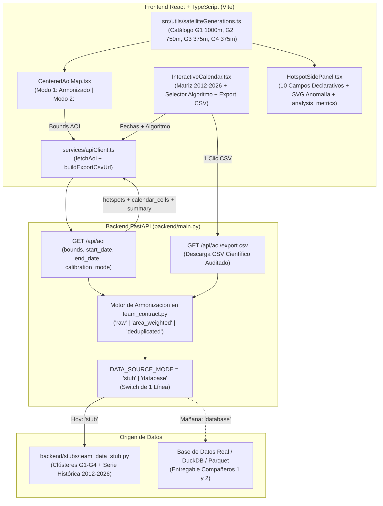
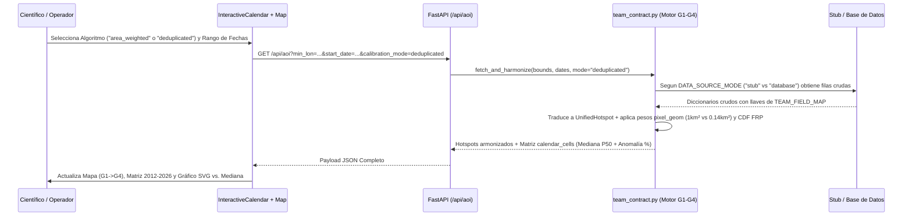

# RUTA 1: ARMONIZACIÓN CIENTÍFICA Y CALIBRACIÓN MULTI-SATÉLITE (MODIS + VIIRS)

> **Rama de destino:** `overnight/ruta-1-armonizacion`  
> **Worktree de ejecución:** `/tmp/overnight-worktrees/ruta-1`  
> **Agente asignado:** `@coder-ruta1`  
> **Enfoque arquitectónico:** Maximizar la armonización estadística MODIS/VIIRS para el desafío *Harmonization of MODIS and VIIRS Hot Spots (CONAE — NASA Space Apps 2026)*. Implementa modos de calibración científica (`'raw'`, `'area_weighted'` ponderado por `pixel_geom` $1.0\text{ km}^2$ vs $0.14\text{ km}^2$, y `'deduplicated'` que fusiona co-detecciones MODIS/VIIRS cercanas en tiempo y espacio), pesos de calibración por generación (`G1`–`G4`), matriz multianual de anomalías (**Burning Activity Calendar 2012–2026**) contra mediana histórica ($P_{50}$), y exportación CSV científica vía endpoint dedicado (`GET /api/aoi/export.csv`).

---

## 1. PROMPT DE EJECUCIÓN DESDE CERO (Copy-Paste Ready)

```markdown
Actúa como Desarrollador Full-Stack Senior especialista en Teledetección Espacial (FastAPI + React + TypeScript + Leaflet).
Tu misión es implementar de punta a punta la "Ruta 1: Armonización Científica Máxima" en la rama `overnight/ruta-1-armonizacion`, partiendo de cero memoria cacheada.

REGLAS DE ORO OBLIGATORIAS:
1. Lee primero `AGENTS.MD`, `docs/TEAM_DATA_CONTRACT.md`, `.agents/rules/data-contract-guard.md`, `docs/overnight/01_INDUSTRIA_SISTEMAS_REALES.md`, `docs/overnight/02_MODELOS_MATEMATICOS_ARMONIZACION.md` y `backend/team_contract.py`.
2. Respeta estrictamente los 10 conceptos canónicos de `TEAM_FIELD_MAP` y `UnifiedHotspot`. NUNCA agregues el campo `version` (excluido por contrato).
3. REGLA DE ORO (Open/Closed Principle): Extiende `UnifiedHotspot` agregando `analysis_metrics: dict[str, Any]` (en Python) / `analysis_metrics?: Record<string, string | number | null>` (en TypeScript). En `HotspotSidePanel.tsx`, renderiza los 10 atributos base mediante un arreglo declarativo (`BASE_FIELD_DESCRIPTORS`) y renderiza `analysis_metrics` iterando dinámicamente sus claves sin acoplar el JSX a nombres fijos.
4. PROHIBIDO ejecutar `npm install` o `uv add` (usa las dependencias ya instaladas).

PASOS DE IMPLEMENTACIÓN (BABY STEPS CON CONVENTIONAL COMMITS EN ESPAÑOL):
- Paso 1 (`feat(contrato): motor de armonizacion cientifica, switch de 1 linea y exportacion CSV`):
  Extender `backend/team_contract.py`, `backend/stubs/team_data_stub.py` y `backend/main.py` con:
  * Switch limpio de 1 sola línea (`DATA_SOURCE_MODE: Literal["stub", "database"] = "stub"`) en `backend/team_contract.py` (y `load_raw_team_rows`) para cambiar a la Base de Datos real cuando el otro equipo termine.
  * Motor de armonización científica configurable con 3 modos (`calibration_mode`: `'raw'`, `'area_weighted'` ponderado por `pixel_geom` 1km² vs 0.14km², y `'deduplicated'` que fusiona detecciones MODIS/VIIRS cercanas en tiempo y espacio con radio cilíndrico adaptativo).
  * Filtrado por `start_date` / `end_date` y cálculo de matriz mensual/multianual (`calendar_cells`, 2012–2026) con mediana histórica (`historical_median`), porcentaje de anomalía (`anomaly_pct`) y severidad (`low`, `normal`, `elevated`, `extreme`).
  * Endpoint `GET /api/aoi/export.csv` en `backend/main.py` que devuelve un `StreamingResponse` / `Response` (`text/csv`) con todos los focos armonizados y sus pesos estadísticos.
- Paso 2 (`feat(mapa): catalogo de 4 generaciones satelitales y huella real en metros`):
  * Crear `frontend/src/utils/satelliteGenerations.ts` con las 4 generaciones satelitales:
    - `G1`: MODIS Terra/Aqua (`T`, `A`), 2012–2026, resolución 1000m (`radiusMeters: 1000`, halo violeta punteado `#7c3aed`, `zOrder: 1`).
    - `G2`: VIIRS S-NPP (`N`), 2012–2026, resolución efectiva 750m (`radiusMeters: 750`, azul `#2563eb`, `zOrder: 2`).
    - `G3`: VIIRS NOAA-20 (`N20`), 2017–2026, resolución 375m (`radiusMeters: 375`, naranja `#ea580c`, `zOrder: 3`).
    - `G4`: VIIRS NOAA-21 (`N21`), 2023–2026, resolución 375m (`radiusMeters: 375`, rojo sólido `#dc2626`, `zOrder: 4`).
  * Actualizar `CenteredAoiMap.tsx` con el Radio Toggle ("Ver puntos armonizados" vs "Discriminar por satélite y huella real en metros" usando `<Circle>` en metros sobre la Tierra ordenado por `zOrder`).
- Paso 3 (`feat(calendario): calendario interactivo funcional, selector de calibracion y exportacion CSV`):
  * Crear `frontend/src/components/InteractiveCalendar.tsx` 100% funcional con selector `Desde`/`Hasta`, clic en celdas mensuales (`calendar_cells`) que filtra el mapa en vivo, selector de algoritmo de armonización (`Ponderado por Área` / `Deduplicado` / `Crudo`) y botón funcional de **Exportar CSV Armonizado** conectado a `/api/aoi/export.csv`.
- Paso 4 (`feat(panel): panel lateral extensible con grafico SVG de anomalia estacional vs mediana`):
  * Hacer 100% declarativo y extensible `HotspotSidePanel.tsx` incorporando en la sección desplegable un Gráfico SVG de Barras de Anomalía Estacional vs. Mediana Histórica y la tabla dinámica de factores de armonización del punto (`analysis_metrics`).
- Paso 5: Verificar con `python` y `tsc --noEmit` con 0 errores.
```

---

## 2. ARQUITECTURA Y FLUJO DE DATOS (MERMAID)

### 2.1. Arquitectura de Armonización Científica y Switch de 1 Línea



### 2.2. Flujo de Calibración Estadística y Deduplicación Cilíndrica



---

## 3. EXPLICACIÓN EXACTA DEL SWAP DE 1 SOLA LÍNEA A BASE DE DATOS REAL

El desacoplamiento entre la aplicación web y el pipeline de datos de los Compañeros 1 y 2 se controla desde **una única constante de configuración** en `backend/team_contract.py` (o la llamada única en `backend/main.py`):

### En `backend/team_contract.py`:

```python
# =====================================================================
# SWITCH DE 1 SOLA LÍNEA PARA CONECTAR LA BASE DE DATOS REAL DEL EQUIPO
# =====================================================================
# Cambiar de "stub" a "database" cuando los Compañeros 1 y 2 entreguen
# la tabla armonizada en DuckDB / Parquet / PostgreSQL.
DATA_SOURCE_MODE: Literal["stub", "database"] = "stub"
```

Y en el cargador de datos desacoplado:

```python
def load_raw_team_rows(
    min_lon: float,
    min_lat: float,
    max_lon: float,
    max_lat: float,
    start_date: Optional[str] = None,
    end_date: Optional[str] = None,
) -> list[dict[str, Any]]:
    if DATA_SOURCE_MODE == "stub":
        from stubs.team_data_stub import generate_stub_team_rows
        return generate_stub_team_rows(min_lon, min_lat, max_lon, max_lat, start_date=start_date, end_date=end_date)
    # Conexión directa a DuckDB / Base de Datos del Equipo:
    from adapters.team_database import query_team_database_rows
    return query_team_database_rows(min_lon, min_lat, max_lon, max_lat, start_date=start_date, end_date=end_date)
```

Si además el equipo cambia algún nombre de columna al entregar su tabla final, solo se edita el string derecho en `TEAM_FIELD_MAP` dentro de `backend/team_contract.py`. Ningún componente de React ni endpoint de FastAPI requiere modificaciones.

---

## 4. ESPECIFICACIÓN TÉCNICA DE COMPONENTES Y MODELOS MATEMÁTICOS

### 4.1. Catálogo de 4 Generaciones Satelitales (`frontend/src/utils/satelliteGenerations.ts`)

| Generación | Códigos `satellite` | Misión / Sensor | Período Operativo | Resolución / Huella (`radiusMeters`) | Estilo Visual en Modo Huella (`<Circle>`) | `zOrder` |
| :--- | :--- | :--- | :--- | :--- | :--- | :--- |
| **G1** | `"T"`, `"A"` | MODIS Terra / Aqua | 2012–2026 | `1000 m` (~$1.0\text{ km}^2$) | Halo violeta punteado (`#7c3aed`, `dashArray: "6 4"`, al fondo) | `1` (Fondo) |
| **G2** | `"N"` | VIIRS S-NPP | 2012–2026 | `750 m` (transición) | Círculo azul (`#2563eb`, opacidad media) | `2` |
| **G3** | `"N20"` | VIIRS NOAA-20 | 2017–2026 | `375 m` (~$0.14\text{ km}^2$) | Círculo naranja (`#ea580c`, opacidad media-alta) | `3` |
| **G4** | `"N21"` | VIIRS NOAA-21 | 2023–2026 | `375 m` (~$0.14\text{ km}^2$) | Núcleo rojo sólido (`#dc2626`, máxima prioridad arriba) | `4` (Frente) |

### 4.2. Tres Algoritmos de Armonización en `backend/team_contract.py`
1. **`raw` (Sin calibrar):** Cada detección cuenta como `1.0` y conserva su `frp` original, exhibiendo el salto artificial post-2012 por la entrada de VIIRS.
2. **`area_weighted` (Ponderación por Área Instantánea `pixel_geom`):** Pondera cada foco por la razón de área respecto al píxel de referencia MODIS de $1.0\text{ km}^2$ ($w_i = (A_i / 1.0\text{ km}^2)^{\beta}$) y aplica calibración de cuantiles (CDF Matching) al `frp`, haciendo comparables las series MODIS y VIIRS en el período 2012–2026.
3. **`deduplicated` (Deduplicación Espacio-Temporal Cilíndrica):** Agrupa co-detecciones situadas a menos de $r_{\text{dedup}} \approx 1.0\text{ km}$ y dentro de la misma ventana temporal ($\Delta t \le 6\text{ h}$), fusionándolas en un foco representativo sin doble conteo de energía radiativa.

### 4.3. Exportación CSV Científica (`GET /api/aoi/export.csv`)
- Genera un archivo CSV con encabezados claros que incluyen los 10 atributos canónicos (`datetime_utc`, `satellite`, `lat`, `lon`, `temp_1`, `temp_2`, `pixel_geom`, `frp`, `confidence`, `fire_type`, `day_night`) más las columnas derivadas de `analysis_metrics` (`generation`, `calibration_mode`, `harmonized_weight`, `harmonized_frp_mw`, `historical_percentile`, `seasonal_anomaly_pct`).

---

## 5. LISTA DE BABY STEPS Y CONVENTIONAL COMMITS EN ESPAÑOL

1. **Baby Step 1 — Motor de Armonización Científica y Switch de 1 Línea (`backend/team_contract.py`, `backend/stubs/team_data_stub.py`, `backend/main.py`):**
   - *Justificación de Meta:* Implementa `UnifiedHotspot.analysis_metrics`, el switch `DATA_SOURCE_MODE = "stub" | "database"`, los 3 algoritmos de armonización (`raw`, `area_weighted`, `deduplicated`), la matriz `calendar_cells` y el endpoint `GET /api/aoi/export.csv`.
   - *Commit:* `feat(backend): implementar motor de armonizacion cientifica, calendario y exportacion CSV`
2. **Baby Step 2 — Catálogo de 4 Generaciones (`satelliteGenerations.ts`) y Mapa con Huella en Metros (`CenteredAoiMap.tsx`):**
   - *Justificación de Meta:* Crea el catálogo G1–G4 y dota al mapa del modo dual (puntos armonizados vs. círculos con radio físico en metros sobre la Tierra ordenados por `zOrder` de G1 al fondo a G4 al frente).
   - *Commit:* `feat(mapa): agregar catalogo satelital G1-G4 y renderizado de huella real en metros`
3. **Baby Step 3 — Calendario Interactivo Funcional (`InteractiveCalendar.tsx`) y Controles de Calibración:**
   - *Justificación de Meta:* Reemplaza la maqueta estática por un calendario interactivo con filtros `Desde`/`Hasta`, celdas mensuales clicables coloreadas por anomalía frente a la mediana histórica, selector de algoritmo y descarga CSV en 1 clic.
   - *Commit:* `feat(calendario): crear InteractiveCalendar funcional con anomalias y descarga CSV`
4. **Baby Step 4 — Panel Lateral Extensible con Gráfico SVG Estacional vs. Mediana (`HotspotSidePanel.tsx` + `App.tsx`):**
   - *Justificación de Meta:* Refactoriza `HotspotSidePanel.tsx` bajo la Regla de Oro (descriptores declarativos + `analysis_metrics` abiertos) e incorpora el gráfico SVG comparativo contra la mediana histórica.
   - *Commit:* `feat(panel): integrar panel declarativo extensible y grafico SVG de anomalia estacional`
