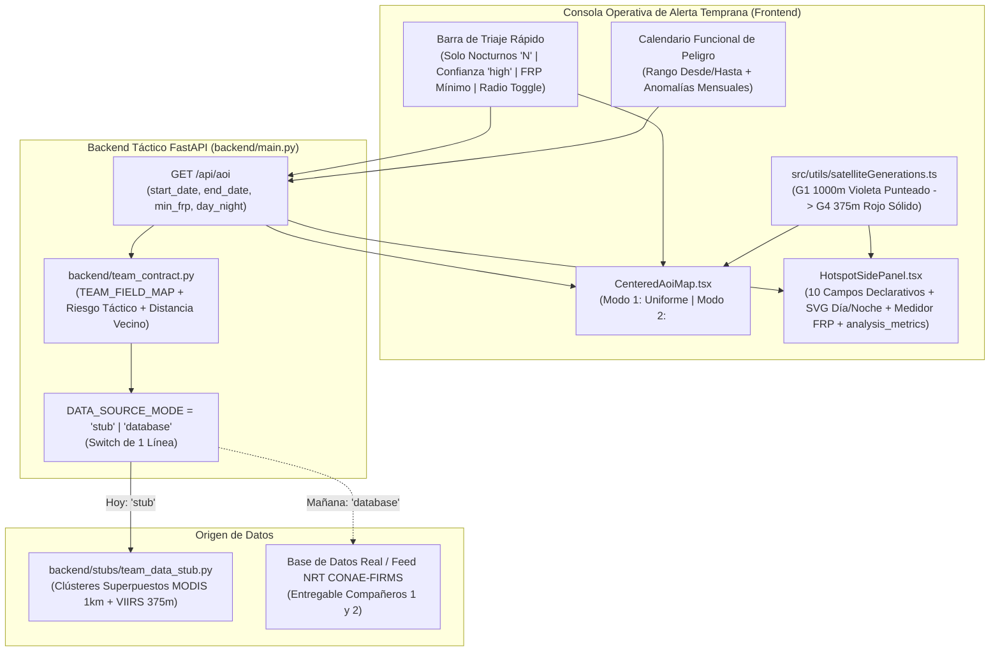
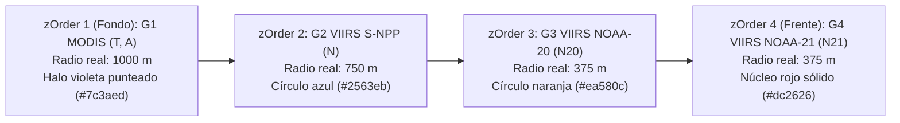

# RUTA 2: ALERTA TEMPRANA OPERATIVA Y TRIAJE TÁCTICO (ESTILO EFFIS / MANEJO DEL FUEGO)

> **Rama de destino:** `overnight/ruta-2-alerta-temprana`  
> **Worktree de ejecución:** `/tmp/overnight-worktrees/ruta-2`  
> **Agente asignado:** `@coder-ruta2`  
> **Enfoque arquitectónico:** Operación táctica y alerta temprana (inspirada en *Copernicus EFFIS*, *GWIS* y *CONAE Emergencias*). Pone el foco en la **auditoría de huella física real en metros (`<Circle>` con `zOrder`)**: `G1` (MODIS `1000m`, halo violeta punteado al fondo) $\rightarrow$ `G2` (VIIRS S-NPP `750m`, azul) $\rightarrow$ `G3` (VIIRS NOAA-20 `375m`, naranja) $\rightarrow$ `G4` (VIIRS NOAA-21 `375m`, núcleo rojo sólido al frente), **Radio Toggle de discriminación por satélite**, **Barra de Triaje Rápido de Emergencias** (persistencia Nocturna `N` vs Diurna `D`, filtro de Confianza Alta y umbral de severidad `FRP`), y calendario funcional de anomalías.

---

## 1. PROMPT DE EJECUCIÓN DESDE CERO (Copy-Paste Ready)

```markdown
Actúa como Arquitecto de Sistemas de Misión Crítica y Desarrollador Full-Stack Senior (FastAPI + React + TypeScript + Leaflet).
Tu misión es implementar de punta a punta la "Ruta 2: Alerta Temprana y Operación Táctica" en la rama `overnight/ruta-2-alerta-temprana`, partiendo de cero memoria cacheada.

REGLAS DE ORO OBLIGATORIAS:
1. Lee primero `AGENTS.MD`, `docs/TEAM_DATA_CONTRACT.md`, `.agents/rules/data-contract-guard.md`, `docs/overnight/01_INDUSTRIA_SISTEMAS_REALES.md` y `backend/team_contract.py`.
2. Respeta estrictamente los 10 conceptos canónicos de `TEAM_FIELD_MAP` y `UnifiedHotspot`. NUNCA agregues el campo `version` (excluido por contrato).
3. REGLA DE ORO (Open/Closed Principle): Extiende `UnifiedHotspot` con `analysis_metrics: dict[str, Any]` (en Python) / `analysis_metrics?: Record<string, string | number | null>` (en TypeScript). En `HotspotSidePanel.tsx`, renderiza los 10 atributos base mediante un arreglo declarativo (`BASE_FIELD_DESCRIPTORS`) y renderiza `analysis_metrics` iterando dinámicamente sus claves.
4. PROHIBIDO ejecutar `npm install` o `uv add`.

PASOS DE IMPLEMENTACIÓN (BABY STEPS CON CONVENTIONAL COMMITS EN ESPAÑOL):
- Paso 1 (`feat(backend): filtrado tactico, metricas de alerta temprana y switch de 1 linea`):
  En `backend/team_contract.py`, `backend/stubs/team_data_stub.py` y `backend/main.py`:
  * Añadir el switch de 1 sola línea `DATA_SOURCE_MODE: Literal["stub", "database"] = "stub"` en `backend/team_contract.py` para conectar la Base de Datos real cuando el otro equipo termine.
  * Implementar filtrado por `start_date`, `end_date`, `min_frp` y `day_night` en `GET /api/aoi` (más `GET /api/aoi/export.csv`).
  * Calcular indicadores de **Alerta Temprana** en `analysis_metrics` de cada punto: nivel de riesgo táctico (`CRÍTICO`, `ALTO`, `MODERADO`), persistencia nocturna (`day_night == 'N'`), radio de incertidumbre en metros (`footprint_radius_m`) y distancia al foco más cercano (`nearest_hotspot_km`), más resumen mensual de actividad para el calendario (`calendar_cells`).
- Paso 2 (`feat(mapa): auditoria de huella fisica en metros G1-G4 con zOrder y clusteres`):
  En `frontend/src/utils/satelliteGenerations.ts` y `frontend/src/components/CenteredAoiMap.tsx`:
  * Definir las 4 generaciones satelitales con su huella física en metros y `zOrder`:
    - `G1`: MODIS Terra/Aqua (`T`, `A`), `1000m`, halo violeta punteado al fondo (`zOrder: 1`).
    - `G2`: VIIRS S-NPP (`N`), `750m`, círculo azul (`zOrder: 2`).
    - `G3`: VIIRS NOAA-20 (`N20`), `375m`, círculo naranja (`zOrder: 3`).
    - `G4`: VIIRS NOAA-21 (`N21`), `375m`, núcleo rojo sólido al frente (`zOrder: 4`).
  * Implementar Radio Toggle en `CenteredAoiMap.tsx` entre **Modo 1** (Puntos rojos uniformes) y **Modo 2** (`<Circle>` con radio real en metros sobre el terreno ordenados por `zOrder`, usando clústeres de superposición en el stub para visualizar cómo los focos VIIRS de 375m caen dentro del halo MODIS de 1000m).
- Paso 3 (`feat(triaje): barra de triaje rapido de emergencias y calendario funcional`):
  * Implementar filtros rápidos en vivo sobre el AOI: Solo Focos Nocturnos (`N` - alta probabilidad de frente activo sostenido), Solo Confianza Alta (`high`), Filtro de FRP mínimo (`min_frp`), y Calendario de Actividad Funcional (`Desde`/`Hasta` + clic en mes).
- Paso 4 (`feat(panel): panel lateral tactico con tarjeta SVG dia/noche, medidor FRP y leyenda G1-G4`):
  * Actualizar `HotspotSidePanel.tsx` con contrato declarativo extensible + Tarjeta SVG de Alerta de Persistencia Día/Noche + Medidor visual de Potencia Radiativa (`FRP` MW) y Leyenda Interactiva de Generaciones Satelitales (`G1–G4`).
- Paso 5: Verificar con `python` y `tsc --noEmit` con 0 errores.
```

---

## 2. ARQUITECTURA Y FLUJO DE DATOS (MERMAID)

### 2.1. Arquitectura de Alerta Temprana, Huella Física G1–G4 y Triaje Táctico



### 2.2. Jerarquía de Capas Geodésicas en el Mapa (`zOrder` G1 → G4)



---

## 3. EXPLICACIÓN EXACTA DEL SWAP DE 1 SOLA LÍNEA A BASE DE DATOS REAL

El cambio entre los datos simulados de entrenamiento táctico (`backend/stubs/team_data_stub.py`) y la base de datos de producción del Equipo 1 y 2 se realiza modificando **una sola línea** en `backend/team_contract.py` (o la llamada única en `backend/main.py`):

### En `backend/team_contract.py`:

```python
# =====================================================================
# SWITCH DE 1 SOLA LÍNEA HACIA LA BASE DE DATOS / API REAL DEL EQUIPO
# =====================================================================
DATA_SOURCE_MODE: Literal["stub", "database"] = "stub"  # Cambiar a "database" en producción
```

Cuando `DATA_SOURCE_MODE` pasa a `"database"`, el cargador invoca la consulta espacial sobre la tabla unificada del equipo y pasa cada fila por `parse_team_record(row)`, calculando automáticamente el nivel de riesgo táctico, la persistencia nocturna y la huella en metros sin tocar ningún archivo de `frontend/`.

---

## 4. ESPECIFICACIÓN TÉCNICA DE TRIAJE Y HUELLA EN METROS

### 4.1. Indicadores de Alerta Temprana en `UnifiedHotspot.analysis_metrics`
- **`"Nivel de Riesgo Táctico"`:** `"CRÍTICO (Despacho Prioritario)"` cuando `day_night == "N"` y `frp >= 50.0` (o `frp >= 90.0`); `"ALTO (Vigilancia Activa)"` cuando `frp >= 35.0`; `"MODERADO"` en el resto.
- **`"Persistencia Nocturna"`:** `"Foco Nocturno Activo (Sin sesgo solar)"` si `day_night == "N"`, fundamental para manejo del fuego porque los incendios nocturnos representan frentes sostenidos con alta probabilidad de propagación al amanecer.
- **`"Radio de Incertidumbre / Huella (m)"`:** `1000` m (`G1`), `750` m (`G2`), `375` m (`G3`/`G4`).
- **`"Distancia al Foco Vecino Más Cercano"`:** distancia geodésica en `km` al foco contiguo del mismo clúster para identificar frentes de fuego continuos.

### 4.2. Clústeres Superpuestos en `backend/stubs/team_data_stub.py`
- El generador crea intencionalmente frentes activos donde un píxel `G1` (`T` o `A`, radio `1000m`) envuelve espacialmente a detecciones `G2` (`N`, `750m`), `G3` (`N20`, `375m`) y `G4` (`N21`, `375m`). Al activar el Modo 2 en `CenteredAoiMap.tsx`, el operador comprueba visualmente que las detecciones de 375m son el núcleo físico exacto dentro del halo grueso de 1000m de MODIS.

---

## 5. LISTA DE BABY STEPS Y CONVENTIONAL COMMITS EN ESPAÑOL

1. **Baby Step 1 — Filtrado Táctico, Métricas de Alerta Temprana y Switch de 1 Línea (`backend/team_contract.py`, `backend/stubs/team_data_stub.py`, `backend/main.py`):**
   - *Justificación de Meta:* Incorpora los filtros operativos (`start_date`, `end_date`, `min_frp`, `day_night`), enriquece `analysis_metrics` con telemetría de emergencia y establece el switch `DATA_SOURCE_MODE = "stub" | "database"`.
   - *Commit:* `feat(backend): implementar filtros tacticos, metricas de alerta temprana y switch de datos`
2. **Baby Step 2 — Catálogo Satelital `satelliteGenerations.ts` y Modo de Huella Física en Metros (`CenteredAoiMap.tsx`):**
   - *Justificación de Meta:* Añade el renderizado dual en el mapa (Puntos Rojos Uniformes vs. `<Circle>` con radio real en metros sobre el terreno ordenados por `zOrder` de G1 1000m violeta punteado al fondo hasta G4 375m rojo sólido al frente).
   - *Commit:* `feat(mapa): implementar modo de huella fisica en metros G1-G4 con zOrder`
3. **Baby Step 3 — Barra de Triaje Rápido de Emergencias y Calendario Funcional (`App.tsx`):**
   - *Justificación de Meta:* Permite a los operadores filtrar en un clic focos nocturnos (`N`), confianza alta (`high`), umbral de FRP mínimo y rango de fechas en el calendario.
   - *Commit:* `feat(triaje): agregar barra de triaje rapido nocturno/FRP y calendario funcional`
4. **Baby Step 4 — Panel Lateral Táctico con Tarjeta SVG Día/Noche, Medidor FRP y Leyenda G1–G4 (`HotspotSidePanel.tsx`):**
   - *Justificación de Meta:* Cumple la Regla de Oro del contrato extensible y añade visualización inmediata de persistencia nocturna, medidor de severidad FRP y leyenda interactiva de las 4 generaciones.
   - *Commit:* `feat(panel): integrar tarjeta SVG de persistencia nocturna, medidor FRP y leyenda G1-G4`
