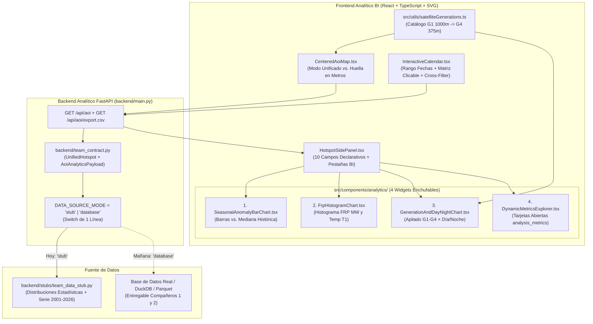
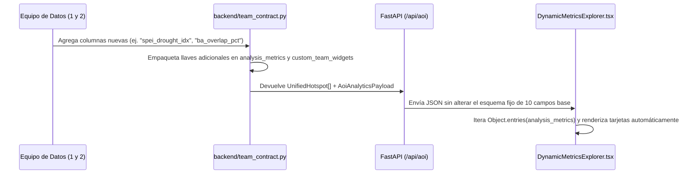

# RUTA 3: EXPLORADOR ANALÍTICO BI Y KIT INTERACTIVO DE GRÁFICOS SVG (CROSS-FILTERING)

> **Rama de destino:** `overnight/ruta-3-analitica-bi`  
> **Worktree de ejecución:** `/tmp/overnight-worktrees/ruta-3`  
> **Agente asignado:** `@coder-ruta3`  
> **Enfoque arquitectónico:** Business Intelligence (BI) ambiental y exploración visual profunda con contrato 100% extensible (`UnifiedHotspot.analysis_metrics` + `AoiAnalyticsPayload` con diccionario abierto `custom_team_widgets`). Incluye una batería completa de **4 componentes visuales SVG enchufables** en `frontend/src/components/analytics/` (`SeasonalAnomalyBarChart.tsx`, `FrpHistogramChart.tsx`, `GenerationAndDayNightChart.tsx`, `DynamicMetricsExplorer.tsx`), catálogo `satelliteGenerations.ts` (`G1`–`G4` con huella en metros y `zOrder`), y `InteractiveCalendar.tsx` con filtrado cruzado.

---

## 1. PROMPT DE EJECUCIÓN DESDE CERO (Copy-Paste Ready)

```markdown
Actúa como Ingeniero Principal de Visualización de Datos, BI Geoespacial y Desarrollador Full-Stack Senior (FastAPI + React + TypeScript + SVG Nativo + Leaflet).
Tu misión es implementar de punta a punta la "Ruta 3: Explorador Analítico y Suite de Gráficos BI" en la rama `overnight/ruta-3-analitica-bi`, partiendo de cero memoria cacheada.

REGLAS DE ORO OBLIGATORIAS:
1. Lee primero `AGENTS.MD`, `docs/TEAM_DATA_CONTRACT.md`, `.agents/rules/data-contract-guard.md`, `docs/overnight/01_INDUSTRIA_SISTEMAS_REALES.md` y `backend/team_contract.py`.
2. Respeta estrictamente los 10 conceptos canónicos de `TEAM_FIELD_MAP` y `UnifiedHotspot`. NUNCA agregues el campo `version` (excluido por contrato).
3. REGLA DE ORO (Open/Closed Principle): Extiende `UnifiedHotspot` con `analysis_metrics: dict[str, Any]` y el payload del AOI con `aoi_analytics` (`AoiAnalyticsPayload`, incluyendo un diccionario abierto `custom_team_widgets`). En `HotspotSidePanel.tsx`, renderiza los 10 atributos base mediante un arreglo declarativo (`BASE_FIELD_DESCRIPTORS`) y renderiza las métricas adicionales sin acoplar el JSX a nombres fijos.
4. PROHIBIDO ejecutar `npm install` o `uv add`.

PASOS DE IMPLEMENTACIÓN (BABY STEPS CON CONVENTIONAL COMMITS EN ESPAÑOL):
- Paso 1 (`feat(backend): contrato analitico extensible AoiAnalyticsPayload y switch de 1 linea`):
  En `backend/team_contract.py`, `backend/stubs/team_data_stub.py` y `backend/main.py`:
  * Diseñar el contrato analítico extensible (`UnifiedHotspot.analysis_metrics` + `AoiAnalyticsPayload` con series mensuales, histogramas de `frp` y `temp_1`, distribución por satélite `G1–G4` y `day_night`, más el diccionario abierto `custom_team_widgets` para datos masticados futuros).
  * Añadir filtrado por `start_date`/`end_date`, endpoint `GET /api/aoi/export.csv` y adaptador de 1 línea (`DATA_SOURCE_MODE = "stub" | "database"`) en `backend/team_contract.py` para cambio futuro a Base de Datos real.
- Paso 2 (`feat(mapa-calendario): catalogo satelliteGenerations, radio toggle y calendario interactivo`):
  En `frontend/src/`:
  * Implementar el catálogo `src/utils/satelliteGenerations.ts` (`G1` MODIS 1000m, `G2` S-NPP 750m, `G3` NOAA-20 375m, `G4` NOAA-21 375m con precisión en metros y `zOrder`).
  * Incorporar el Radio Toggle en el mapa (`CenteredAoiMap.tsx` con modo unificado vs. huella real en metros `<Circle>` ordenado por `zOrder`).
  * Crear el Calendario Interactivo Funcional (`src/components/InteractiveCalendar.tsx` con selector `Desde`/`Hasta` y matriz clicable Año×Mes).
- Paso 3 (`feat(analitica): bateria de 4 componentes visuales SVG enchufables`):
  Construir en `frontend/src/components/analytics/`:
  1. `SeasonalAnomalyBarChart.tsx`: Gráfico de barras mensual comparando el conteo/FRP del período contra la mediana histórica ($P_{50}$).
  2. `FrpHistogramChart.tsx`: Histograma de distribución de frecuencias de Potencia Radiativa (`FRP` en MW) y brillo térmico (`temp_1`).
  3. `GenerationAndDayNightChart.tsx`: Gráfico de barras horizontales apiladas mostrando el aporte por Generación (`G1–G4`) y proporción Día (`D`) vs. Noche (`N`).
  4. `DynamicMetricsExplorer.tsx`: Renderizador automático de tarjetas/tablas para cualquier métrica masticada extra que entregue el equipo de datos en `analysis_metrics` y `custom_team_widgets`.
- Paso 4 (`feat(panel): integrar suite BI con pestañas en HotspotSidePanel`):
  Integrar todo en `HotspotSidePanel.tsx` con pestañas en la sección desplegable y verificar que backend + TypeScript (`tsc --noEmit`) pasen sin errores.
```

---

## 2. ARQUITECTURA Y FLUJO DE DATOS (MERMAID)

### 2.1. Arquitectura Modular BI y Suite de 4 Widgets SVG



### 2.2. Flujo de Extensibilidad Open/Closed para Métricas Masticadas del Equipo



---

## 3. EXPLICACIÓN EXACTA DEL SWAP DE 1 SOLA LÍNEA A BASE DE DATOS REAL

El acoplamiento con el generador de pruebas está aislado detrás del switch de 1 línea en `backend/team_contract.py`:

```python
# =====================================================================
# SWITCH DE 1 SOLA LÍNEA HACIA LA BASE DE DATOS REAL DEL EQUIPO
# =====================================================================
DATA_SOURCE_MODE: Literal["stub", "database"] = "stub"  # Cambiar a "database" al recibir tabla final
```

Al cambiar `DATA_SOURCE_MODE = "database"`, toda la batería de 4 componentes SVG (`SeasonalAnomalyBarChart`, `FrpHistogramChart`, `GenerationAndDayNightChart`, `DynamicMetricsExplorer`) y el `InteractiveCalendar` pasan automáticamente a graficar los datos reales de los Compañeros 1 y 2 sin modificar una sola línea de TypeScript.

---

## 4. ESPECIFICACIÓN DE LA SUITE DE 4 COMPONENTES SVG (`src/components/analytics/`)

1. **`SeasonalAnomalyBarChart.tsx`:**
   - Renderiza un gráfico SVG de barras mensuales/estacionales comparando la actividad medida frente a la línea punteada de la **Mediana Histórica ($P_{50}$)**, coloreando cada barra según el desvío porcentual (`anomaly_pct`).
2. **`FrpHistogramChart.tsx`:**
   - Renderiza el histograma de distribución de frecuencias de **Potencia Radiativa (`FRP` en MW)** y temperatura de brillo (`temp_1` en Kelvin), destacando la asimetría derecha y los focos de cola extrema ($>P_{90}$).
3. **`GenerationAndDayNightChart.tsx`:**
   - Renderiza barras horizontales apiladas para `G1 (MODIS 1000m)`, `G2 (VIIRS S-NPP 750m)`, `G3 (VIIRS NOAA-20 375m)` y `G4 (VIIRS NOAA-21 375m)`, subdivididas por proporción Diurna (`D`) vs. Nocturna (`N`).
4. **`DynamicMetricsExplorer.tsx`:**
   - Cumple al 100% la Regla de Oro renderizando dinámicamente todas las métricas presentes en `selectedHotspot.analysis_metrics` y en `aoi_analytics.custom_team_widgets`.

---

## 5. LISTA DE BABY STEPS Y CONVENTIONAL COMMITS EN ESPAÑOL

1. **Baby Step 1 — Contrato Analítico Extensible `AoiAnalyticsPayload` y Switch de 1 Línea (`backend/`):**
   - *Justificación de Meta:* Extiende `UnifiedHotspot` con `analysis_metrics`, crea `AoiAnalyticsPayload` con histogramas y series estacionales, y deja listo `DATA_SOURCE_MODE = "stub" | "database"`.
   - *Commit:* `feat(backend): disenar contrato AoiAnalyticsPayload extensible y switch de 1 linea`
2. **Baby Step 2 — Catálogo `satelliteGenerations.ts`, Radio Toggle en Mapa y `InteractiveCalendar.tsx` (`frontend/`):**
   - *Justificación de Meta:* Incorpora las 4 generaciones satelitales con huella real en metros (`<Circle>` con `zOrder`) y habilita el calendario interactivo Año×Mes con selector de fechas.
   - *Commit:* `feat(mapa-calendario): agregar catalogo G1-G4, huella en metros y calendario interactivo`
3. **Baby Step 3 — Batería de 4 Componentes Visuales SVG Enchufables (`frontend/src/components/analytics/`):**
   - *Justificación de Meta:* Construye `SeasonalAnomalyBarChart.tsx`, `FrpHistogramChart.tsx`, `GenerationAndDayNightChart.tsx` y `DynamicMetricsExplorer.tsx` en SVG nativo puro.
   - *Commit:* `feat(analitica): construir suite de 4 graficos SVG interactivos para exploracion BI`
4. **Baby Step 4 — Integración por Pestañas en `HotspotSidePanel.tsx` y Filtrado Cruzado (`frontend/src/`):**
   - *Justificación de Meta:* Integra la suite BI dentro de la sección desplegable del panel lateral manteniendo el renderizado declarativo de los 10 atributos canónicos.
   - *Commit:* `feat(panel): integrar suite analitica BI por pestañas y filtrado cruzado en panel lateral`
