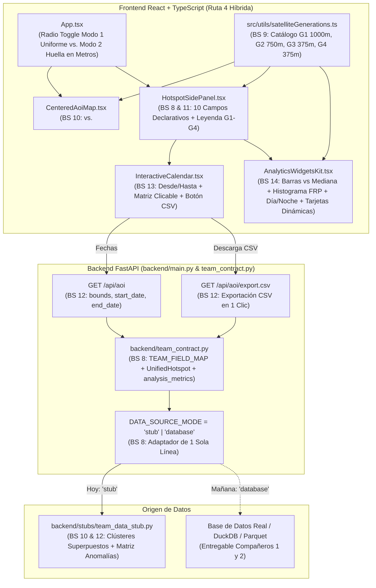
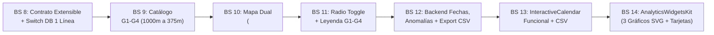

# RUTA 4: ARQUITECTURA HÍBRIDA INTEGRAL Y BALANCEADA (CIENTÍFICA + OPERATIVA + BI)

> **Rama de destino:** `overnight/ruta-4-hibrida-integral`  
> **Worktree de ejecución:** `/tmp/overnight-worktrees/ruta-4`  
> **Agente asignado:** `@coder-ruta4`  
> **Enfoque arquitectónico:** El equilibrio ideal entre la **Ruta 1 (Armonización Científica)** y las **Rutas 2/3 (Alerta Temprana + Kit Analítico SVG + Huella en Metros G1–G4 + Calendario Funcional + Swap de 1 línea a Base de Datos Real)**, implementando los **Baby Steps 8 al 14** del plan maestro.

---

## 1. PROMPT DE EJECUCIÓN DESDE CERO (Copy-Paste Ready)

```markdown
Actúa como Arquitecto Principal y Desarrollador Full-Stack Senior (FastAPI + React + TypeScript + Leaflet + SVG).
Tu misión es implementar de punta a punta la "Ruta 4: Arquitectura Híbrida Integral" en la rama `overnight/ruta-4-hibrida-integral`, combinando lo mejor de la armonización científica, la operación táctica de alerta temprana y la exploración BI a través de los Baby Steps 8 al 14 del plan maestro.

REGLAS DE ORO OBLIGATORIAS:
1. Lee primero `AGENTS.MD`, `docs/TEAM_DATA_CONTRACT.md`, `.agents/rules/data-contract-guard.md`, `docs/overnight/01_INDUSTRIA_SISTEMAS_REALES.md`, `docs/overnight/02_MODELOS_MATEMATICOS_ARMONIZACION.md` y `backend/team_contract.py`.
2. Respeta estrictamente los 10 conceptos canónicos de `TEAM_FIELD_MAP` y `UnifiedHotspot`. NUNCA agregues el campo `version` (excluido por contrato).
3. REGLA DE ORO (Open/Closed Principle): Extiende `UnifiedHotspot` con `analysis_metrics` extensible y haz que `HotspotSidePanel.tsx` sea 100% declarativo y extensible.
4. PROHIBIDO ejecutar `npm install` o `uv add`.

SECUENCIA EXACTA DE IMPLEMENTACIÓN (BABY STEPS 8 AL 14 CON CONVENTIONAL COMMITS EN ESPAÑOL):
- Baby Step 8 (`refactor(contrato): hacer extensible el modelo UnifiedHotspot y el panel lateral con adaptador de BD`):
  * Modelo `UnifiedHotspot` con `analysis_metrics: dict[str, Any]` extensible.
  * Adaptador de Base de Datos intercambiable en 1 sola línea (`DATA_SOURCE_MODE = "stub" | "database"` en `backend/team_contract.py`).
  * Renderizado 100% declarativo de los 10 atributos canónicos en `HotspotSidePanel.tsx`.
- Baby Step 9 (`feat(satelites): crear catalogo configurable de las 4 generaciones satelitales G1-G4`):
  * Catálogo configurable `frontend/src/utils/satelliteGenerations.ts`:
    - `G1`: MODIS Terra/Aqua (`T`, `A`), 2000–2026, `1000m`, halo violeta punteado (`zOrder: 1`).
    - `G2`: VIIRS S-NPP (`N`), 2012–2026, `750m`, círculo azul (`zOrder: 2`).
    - `G3`: VIIRS NOAA-20 (`N20`), 2017–2026, `375m`, círculo naranja (`zOrder: 3`).
    - `G4`: VIIRS NOAA-21 (`N21`), 2023–2026, `375m`, núcleo rojo sólido (`zOrder: 4`).
- Baby Step 10 (`feat(mapa): implementar renderizado dual con huella fisica real en metros y zOrder G1-G4`):
  * Renderizado dual en `CenteredAoiMap.tsx`:
    - Modo 1 (`"harmonized"`): Puntos rojos iguales / armonizados.
    - Modo 2 (`"satellite"`): `<Circle>` con radio real en metros sobre la Tierra y `zOrder` (`G1` al fondo -> `G4` al frente), acompañado de clústeres superpuestos en `backend/stubs/team_data_stub.py`.
- Baby Step 11 (`feat(ui): agregar selector radio toggle de visualizacion y leyenda interactiva de generaciones`):
  * Selector Radio Toggle en `App.tsx` ("Ver puntos armonizados" vs. "Discriminar por satélite y huella real en metros") y tarjeta de leyenda interactiva de las 4 generaciones en `HotspotSidePanel.tsx`.
- Baby Step 12 (`feat(backend): soportar filtrado por fechas, matriz de calendario con anomalias y exportacion CSV`):
  * Filtrado por `start_date`/`end_date` en `GET /api/aoi`, generación de matriz `calendar_cells` con mediana histórica ($P_{50}$) y anomalías en `team_data_stub.py`, y endpoint `GET /api/aoi/export.csv` para exportación CSV en 1 clic.
- Baby Step 13 (`feat(calendario): construir componente InteractiveCalendar funcional con seleccion mensual y descarga CSV`):
  * Componente `frontend/src/components/InteractiveCalendar.tsx` funcional con inputs `Desde`/`Hasta`, celdas mensuales clicables coloreadas por severidad de anomalía, y botón de descarga CSV.
- Baby Step 14 (`feat(analitica): integrar AnalyticsWidgetsKit con graficos SVG estacionales, histograma FRP y balance dia/noche`):
  * Kit modular `frontend/src/components/AnalyticsWidgetsKit.tsx` en la sección desplegable del panel lateral: (1) Gráfico de Barras Estacional vs. Mediana, (2) Histograma de Potencia Radiativa FRP, (3) Balance Día/Noche + Generación Satelital, y (4) Tarjetas dinámicas para datos masticados (`analysis_metrics`).
- Verificar con `python` y `tsc --noEmit` con 0 errores.
```

---

## 2. ARQUITECTURA Y FLUJO DE DATOS (MERMAID)

### 2.1. Arquitectura Híbrida Integral (Baby Steps 8 → 14)



### 2.2. Secuencia de los Baby Steps 8 al 14



---

## 3. EXPLICACIÓN EXACTA DEL SWAP DE 1 SOLA LÍNEA A BASE DE DATOS REAL

Implementado en el **Baby Step 8** dentro de `backend/team_contract.py`:

```python
# =====================================================================
# ADAPTADOR DE FUENTE DE DATOS INTERCAMBIABLE EN 1 LÍNEA (BABY STEP 8)
# =====================================================================
DATA_SOURCE_MODE: Literal["stub", "database"] = "stub"  # Cambiar a "database" cuando el equipo entregue la BD
```

La función `fetch_raw_hotspot_records(...)` evalúa `DATA_SOURCE_MODE`:
- Mientras es `"stub"`, consume `generate_stub_team_rows(...)` desde `backend/stubs/team_data_stub.py`.
- Al cambiar la constante a `"database"`, ejecuta la consulta contra el motor DuckDB / Parquet / SQL entregado por los Compañeros 1 y 2, pasando cada fila por `parse_team_record(row)` y alimentando automáticamente el mapa dual, el `InteractiveCalendar`, el `AnalyticsWidgetsKit` y el endpoint `/api/aoi/export.csv`.

---

## 4. LISTA DETALLADA DE BABY STEPS (8 AL 14) Y CONVENTIONAL COMMITS

1. **Baby Step 8 — Contrato Extensible y Switch de 1 Línea (`backend/team_contract.py`, `frontend/src/components/HotspotSidePanel.tsx`):**
   - *Justificación de Meta:* Garantiza el principio Open/Closed (`analysis_metrics` abiertos + descriptores declarativos para los 10 atributos base) y deja listo el switch `DATA_SOURCE_MODE = "stub" | "database"`.
   - *Commit:* `refactor(contrato): hacer extensible UnifiedHotspot y HotspotSidePanel con switch de BD en 1 linea`
2. **Baby Step 9 — Catálogo Configurable de las 4 Generaciones Satelitales (`frontend/src/utils/satelliteGenerations.ts`):**
   - *Justificación de Meta:* Centraliza la definición física y visual de `G1` (MODIS 1000m), `G2` (S-NPP 750m), `G3` (NOAA-20 375m) y `G4` (NOAA-21 375m) con su `zOrder` y estilos de trazo.
   - *Commit:* `feat(satelites): crear catalogo configurable satelliteGenerations para G1-G4`
3. **Baby Step 10 — Renderizado Dual en Mapa con Huella Física en Metros (`CenteredAoiMap.tsx` + `team_data_stub.py`):**
   - *Justificación de Meta:* Permite alternar entre puntos rojos uniformes y círculos geodésicos `<Circle>` con radio real en metros sobre la Tierra ordenados de `G1` (fondo) a `G4` (frente) sobre clústeres superpuestos.
   - *Commit:* `feat(mapa): implementar renderizado dual con huella real en metros y zOrder G1-G4`
4. **Baby Step 11 — Selector Radio Toggle en Cabecera y Leyenda Interactiva (`App.tsx` + `HotspotSidePanel.tsx`):**
   - *Justificación de Meta:* Otorga al usuario control directo para discriminar por satélite/huella en metros e inspeccionar la ficha técnica de cada generación.
   - *Commit:* `feat(ui): agregar radio toggle de modo de mapa y leyenda interactiva de generaciones`
5. **Baby Step 12 — Backend con Filtrado por Fechas, Matriz `calendar_cells` y Exportación CSV (`backend/main.py` + `team_data_stub.py`):**
   - *Justificación de Meta:* Habilita el filtrado temporal (`start_date`/`end_date`), el cálculo de anomalías frente a la mediana histórica y el endpoint `GET /api/aoi/export.csv`.
   - *Commit:* `feat(backend): soportar filtro de fechas, matriz de calendario con anomalias y endpoint export.csv`
6. **Baby Step 13 — Componente `InteractiveCalendar.tsx` Funcional (`frontend/src/components/InteractiveCalendar.tsx`):**
   - *Justificación de Meta:* Reemplaza el mock del calendario por un selector interactivo con fechas `Desde`/`Hasta`, celdas mensuales clicables coloreadas por anomalía y botón de descarga CSV en 1 clic.
   - *Commit:* `feat(calendario): construir InteractiveCalendar funcional con filtro mensual y descarga CSV`
7. **Baby Step 14 — Kit Analítico Modular `AnalyticsWidgetsKit.tsx` (`frontend/src/components/AnalyticsWidgetsKit.tsx`):**
   - *Justificación de Meta:* Corona la sección desplegable del panel lateral con el Gráfico SVG Estacional vs. Mediana, el Histograma de Potencia Radiativa FRP, el Balance Día/Noche + Generación Satelital y las tarjetas dinámicas de `analysis_metrics`.
   - *Commit:* `feat(analitica): integrar AnalyticsWidgetsKit con graficos SVG y tarjetas dinamicas`
